# System Architecture Document

## 1. Introduction

### 1.1 Purpose

This document describes the architecture of the whole Authentic Memory stack as one system: the tools an institution runs, the hosted services, the independent verifier, the deployment code and the proof record format that ties them together. It gives developers, partner institutions' IT staff, reviewers and funders one map of what exists, what is being built and what is only proposed.

It follows ISO/IEC/IEEE 42010. Each viewpoint section names the concerns it addresses and carries its diagram twice: as Mermaid source and as a rendered PNG.

**Changes in version 2.0.1.** Thirteen explanatory figures are added, lettered 1a to 9a. Each follows the numbered view or the table it explains, so Figures 1 to 9 keep their numbers. They are drawn in the project's house style, defined in the [diagram style guide](../.agents/kb/diagram-style-guide.md). The text, the tables and the nine Mermaid views are unchanged from version 2.

### 1.2 Scope

**System of interest.** Everything that delivers the Authentic Memory service:

| Element | Repository | Version | State |
|---|---|---|---|
| GAMI Hash, offline hashing tool | `authenticmemory/gami-hash` | 1.5.0 | Built, released |
| GAMI Submit, submission format and validator | `authenticmemory/submission-format` | gami-submit-1.0 | Built, released |
| Institutional portal and public verifier | `authenticmemory/gami-app` (code root `gami-webapp/`) | not stated | Built, live |
| Verifiable seal, badge for catalogue pages | `authenticmemory/gami-verifiable-seal` | not stated | Built; widget release due 31 Dec 2026 |
| GAMI Verify, independent CLI verifier | `authenticmemory/gami-cli-verifier` | 0.4.1 in the product notes, 0.4.3 in the issue report | Built, released |
| Deployment code | `authenticmemory/gami-infra` | not stated | Built |
| GAMI Local, workstation app for the sovereign path | `authenticmemory/gami-local` | 0.1.0 | In development, not production-ready |
| GAMI CLI | `authenticmemory/gami-cli` | not stated | One open issue; contents unknown |
| Proof record format | GPR v1 in code; Open Proof Record v2.0.2 as working draft | v1 / 2.0.2 draft | v1 built; v2 not implemented |

Out of scope: the institutions' own preservation systems, the OpenTimestamps calendars, Bitcoin and the proposed time-stamping authorities. They appear as external actors.

**Evidence and its limits.** The code repositories are not in this analysis repository. Statements about code rest on the code-mapping report, which read each repository at one commit on 25 November 2026 and did not run anything or inspect a deployment. Where that report and the planning documents disagree, this document follows the code and records the conflict in [section 10](#10-conflicts-gaps-and-risks).

Every element is labelled with one of five states:

| State | Meaning |
|---|---|
| **Built** | Found in code |
| **Partial** | In code, with a stated gap |
| **In progress** | Being built; not released |
| **Proposed** | A draft decision or specification exists |
| **Planned** | On the roadmap only |

### 1.3 References

The skill expects a PRD, an SRS and an implementation plan. None exists in this repository. The nearest sources are listed in their place.

- **PRD:** none. Nearest: [Product vision](./Software-dev/V1/V1-Product/000-product-vision.md) and [Competing options](./Software-dev/V1/V1-Product/001-competing-options.md).
- **SRS:** none. User requirements U-01 to U-56 exist only inside [About Authentic Memory (PDF)](../references/AuthenticMemory/About-AuthenticMemory.pdf); its functional, non-functional, performance and security requirement sections are empty headings.
- **Implementation plan:** none. Nearest: the [milestones timeline](./Software-dev/V1/V1-to-be-and-roadmap/authentic-memory-milestones-timeline.png) and the [issue mapping report](./Software-dev/gami-issue-function-mapping.md).
- **ADRs:** [V1 ADRs](./Software-dev/V1/V1%20ADRs/) (ADR-001 to ADR-020, Accepted) and [reports/ADRs/](./ADRs/), which holds [ADR-RFC3161](./ADRs/ADR-RFC3161.md) (proposed ADR-021).
- **Technical stack:** [001-technical-stack.md](./Software-dev/V1/V1-to-be-and-roadmap/001-technical-stack.md) and the [to-be component map](./Software-dev/V1/V1-to-be-and-roadmap/authentic-memory--to-be-architecture.png).
- **Code evidence:** [Function-to-code mapping](./Software-dev/gami-function-code-mapping.md), [functional classification](./Software-dev/gami-functional-classification.md), [proof record explainer (PDF)](./Software-dev/gpr-proof-record-explainer.pdf).
- **Proof record:** [Open Proof Record 2.0.2 working draft](../references/GPR/GRPv2.0.2.md), its [schema](../references/GPR/GRPv2.0.2-schema.json) and [context](../references/GPR/GRPv2.0.2-context.jsonld); [GPR v2.0.1 specification draft](./GPRv2/gpr-v2.0.1.md); [OPR vocabulary](./GPRv2/open-proof-record-vocabulary.md); [C2PA, PROV and PREMIS crosswalk](./Crosswalking/c2pa-prov-premis-crosswalk.md).
- **Anchoring:** [Anchoring alternatives report](./Anchoring-alternatives/authenticmemory-anchoring-alternatives.md).
- **Theory:** [Rooting Proof Records in Spacetime](./Theory/Rooting-Proof-Records-in-Spacetime--plus-Diplomatics--and-Susskind.md), [vidimus definition report](./Theory/vidimus-definition-report.md), [Bitcoin trust anchor paper](./Theory/car-bitcoin-trust-anchor.md), [diplomatic framework](./Theory/car-diplomatic-framework.md).
- **Product references:** [GAMI Technical Architecture (PDF)](../references/AuthenticMemory/GAMI-Technical-Architecture.pdf), [customer reference document (PDF)](../references/AuthenticMemory/GAMI-customer-reference-doc.pdf), [2027 risks deck (PDF)](../references/AuthenticMemory/SLIDEDECK-AuthenticMemory-2027-RISKS-MITIGATION.pdf), [portal UX mockup](../requirements/UX-requirements-am-portal-mockup-pablo-nov.html).
- **Standards:** [ISO 42010 ADR rules](../.agents/kb/iso-42010-adr.md); [InterPARES 1 Authenticity Task Force report (PDF)](../references/InterPARES/interpares-1/interpares_book_d_part1_Authenticity_Task_Force_report.pdf); the [ontologies](../references/ontologies/) and [vocabularies](../references/vocabularies/) folders.

[Appendix A](#appendix-a-source-coverage) records how each source folder was read.

### 1.4 Architectural Principles

The template's generic principles are replaced by the ones this stack is built on. Each comes from the product vision, an ADR or the theory reports.

| # | Principle | What it constrains | Source |
|---|---|---|---|
| 1 | **Files never leave the institution.** Only hashes, identifiers and chosen metadata are sent. | No upload path for content exists anywhere in the stack. | [ADR-009](./Software-dev/V1/V1%20ADRs/ADR-009-read-only-post-ingestion-integration.md) |
| 2 | **Read-only towards preservation systems.** No plugins, schema changes or writes to masters. | Integration is by exported manifest. Write-back, such as a PREMIS event, is an institution-side act. | [ADR-009](./Software-dev/V1/V1%20ADRs/ADR-009-read-only-post-ingestion-integration.md) |
| 3 | **Authentic Memory is not on the validity path.** A proof must verify with the file, the record, the institution's key and public anchor data. | Discovery (the index) is kept separate from validity (the record). An independent verifier must exist. | [ADR-006](./Software-dev/V1/V1%20ADRs/ADR-006-gami-proof-record-format.md), [ADR-016](./Software-dev/V1/V1%20ADRs/ADR-016-independent-cli-verifier.md) |
| 4 | **The institution is its own trust root.** Keys live on hardware the institution holds; identity is published on its own domain. | Authentic Memory never holds a private key. No central trust list. | [ADR-005](./Software-dev/V1/V1%20ADRs/ADR-005-hardware-key-webauthn-signing.md), [ADR-008](./Software-dev/V1/V1%20ADRs/ADR-008-did-web-institutional-identity.md) |
| 5 | **Authority from the institution, time from the anchor.** The signature says who vouches; the anchor says no later than when. | Anchors sit outside the signed form and can be added without re-signing. | [OPR 2.0.2](../references/GPR/GRPv2.0.2.md), [trust anchor paper](./Theory/car-bitcoin-trust-anchor.md) |
| 6 | **A proof record attests conformity, not truth.** It proves integrity, attestation, inclusion and existence in time. It does not prove content accuracy, authorship or the state of the file before first hashing. | Verifier output must separate what is proven from what the custodian declares. | [vidimus report](./Theory/vidimus-definition-report.md), [OPR 2.0.2](../references/GPR/GRPv2.0.2.md) |
| 7 | **Independent witnesses, each named with its trust basis.** Copies of one trace are one witness. | A second anchor must not rely on Bitcoin. The verifier shows each anchor on its own line and never merges them. | [Rooting Proof Records](./Theory/Rooting-Proof-Records-in-Spacetime--plus-Diplomatics--and-Susskind.md), [ADR-RFC3161](./ADRs/ADR-RFC3161.md) |
| 8 | **Append-only evidence.** A signed form is never changed. Corrections are new records that name their predecessor. | Replace and withdraw are separate signed documents. | [OPR 2.0.2](../references/GPR/GRPv2.0.2.md) |
| 9 | **Every digest and signature names its algorithm.** | Renewal with stronger algorithms must be possible without a format break. | [Anchoring report](./Anchoring-alternatives/authenticmemory-anchoring-alternatives.md) |
| 10 | **Open standards, open source, no prison.** | Published specification, portable per-file proof, permissive licences. | [ADR-020](./Software-dev/V1/V1%20ADRs/ADR-020-open-source-licensing.md) |
| 11 | **Procedure over technology.** InterPARES holds that authenticity is assured mainly by procedure and that a digital signature alone is not enough over the long term. | The record carries identity and custody as signed data and is evidence toward the InterPARES requirements, not a certificate of authenticity. | [InterPARES Authenticity Task Force](../references/InterPARES/interpares-1/interpares_book_d_part1_Authenticity_Task_Force_report.pdf) |

## 2. Context & Stakeholder Viewpoint (ISO 42010)

*Addresses: Who interacts with the system, external dependencies, and what the key stakeholder concerns are.*

### 2.1 Stakeholders & Concerns

| Stakeholder | Concerns | Addressed in |
|---|---|---|
| **Custodian institutions**: archives, memorial sites, museums. Live pilots are Dachau and Flossenbürg; written commitments include the Bundesarchiv. | Keep custody and authority. Masters untouched. Proofs that outlive Authentic Memory. Little IT capacity in small archives. | Sections 3, 4, 6 |
| **Signing officers and key custodians** | A signing act they can inspect and understand. Key custody that works in practice: setup took 45 minutes instead of 5 in pilots, and keys were shared. | Section 6 |
| **Archivists and metadata preparers** | Hash without changing files. Know which columns become public before signing. | Sections 3, 4 |
| **Institutional IT and security staff** | Every network connection, permission and dependency of installed tools is documented. National archives take months to review external code. | Sections 5, 6 |
| **National archives with a sovereignty mandate** (the Bundesarchiv asked for a fully self-sovereign setup) | Run assembly, anchoring and verification on their own systems. | Sections 3, 5 |
| **Readers, journalists, researchers, educators, courts** | Check a file without an account or technical skill. See which claims are proven and which are declared. Legal weight of the time evidence. | Sections 6, 7 |
| **Independent verifiers and auditors** | Reproduce every check with open tools and a frozen specification. | Sections 3, 4 |
| **Data subjects and rights holders** | Personal data in public metadata cannot be recalled once replicated. Public hashes confirm what an institution holds. | Sections 4, 6 |
| **Authentic Memory operators and maintainers** (a small team with no dedicated tech lead) | Operability by few people. Backup and restore. One codebase to secure. | Sections 5, 7 |
| **Funders**: Stiftung EVZ, BKM, Google.org | Dated commitments on 31 Dec 2026, 31 Jan 2027 and 30 Apr 2027. No funding is secured after April 2027. | Section 10 |
| **Advisory board and standards community**: InterPARES, PREMIS, C2PA | Conformity with archival theory. Interoperability. An open standard others can implement. | Sections 1.4, 4 |
| **Operators of infrastructure the stack depends on**: OpenTimestamps calendars, Bitcoin, time-stamping authorities, GitHub, Hetzner, Cloudflare | None of these is controlled by Authentic Memory. | Sections 5, 7 |

### 2.2 Context Diagram

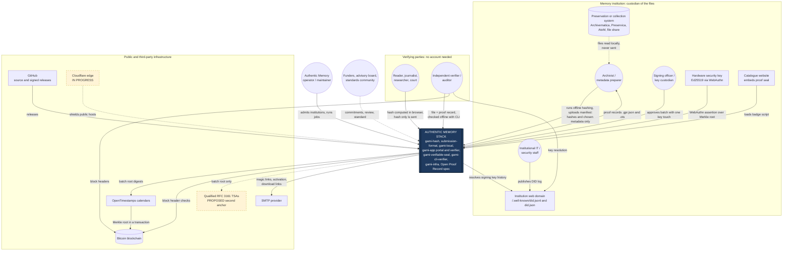

*Figure 1. System context. The stack sits between institutions that hold files, parties that verify them, and public infrastructure that supplies time evidence. Dashed elements are proposed or in progress.*

What crosses each boundary:

| Boundary | Crosses it | Never crosses it |
|---|---|---|
| Institution to hosted services | SHA-256 hashes, identifiers, filenames, chosen metadata, a WebAuthn assertion | Original files, private keys |
| Hosted services to anchors | The stamping-tree root of a batch | File hashes, metadata |
| Verifier to hosted services | A 64-character hash | The file being checked |
| Hosted services to verifier | The proof record and per-check results | Nothing private; records are public |

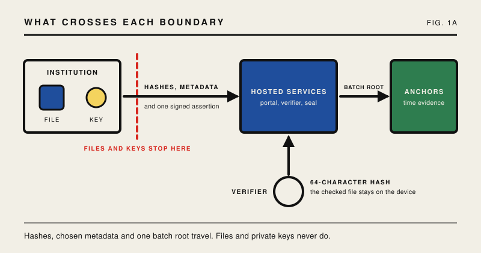

*Figure 1a. What crosses each boundary. Hashes, chosen metadata and one signed assertion reach the hosted services, and only a batch root reaches the anchors. Files and private keys stay with the institution.*

## 3. Functional/Logical Viewpoint (ISO 42010)

*Addresses: How the system is subdivided into modules, their responsibilities, and how they interact logically.*

### 3.1 Logical Architecture

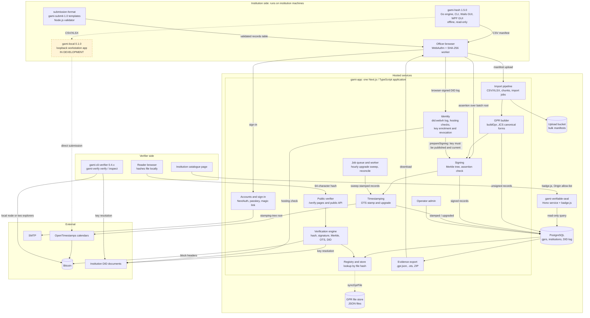

*Figure 2. Logical components as found in code, grouped by where they run. The twelve boxes inside gami-app are the component names used by the code-mapping report.*

**Functions.** The [functional classification](./Software-dev/gami-functional-classification.md) defines nine functions with 40 sub-functions. The table maps each to the components that carry it and to the coverage the code mapping found.

| # | Function | Components | Implemented | Partial | Not in code |
|---|---|---|---|---|---|
| 1 | Admit and register partner institutions | Operator admin, Accounts and sign-in | 1 | 1 | 1 |
| 2 | Establish institutional identity | Identity, hardware key, institution domain | 3 | 2 | 0 |
| 3 | Prepare collections for anchoring | gami-hash, submission-format, Import pipeline | 1 | 2 | 2 |
| 4 | Create proof records | GPR builder | 2 | 3 | 0 |
| 5 | Sign proof records | Signing, hardware key | 1 | 1 | 1 |
| 6 | Timestamp proof records | Timestamping, job worker | 0 | 2 | 1 |
| 7 | Publish, index and retain | Registry and store, Evidence export, seal | 0 | 3 | 1 |
| 8 | Verify proof records | Verification engine, Public verifier, gami-cli-verifier | 1 | 3 | 0 |
| 9 | Maintain proof records over time | Operator scripts only | 0 | 3 | 5 |
| | **Total** | | **9** | **20** | **11** |

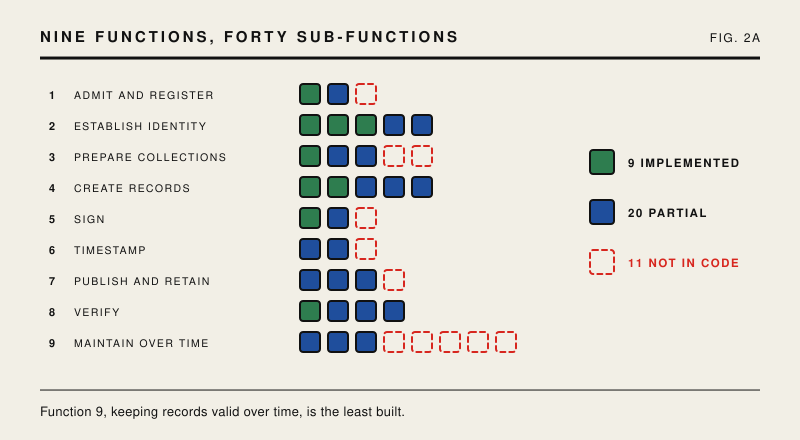

*Figure 2a. Coverage of the 40 sub-functions, one square each, in the order implemented, partial, not in code.*

**Three operating paths.** The components combine into three ways of working, which an institution can mix:

| Path | Who assembles and anchors | Components used | State |
|---|---|---|---|
| Managed | The institution uploads a manifest to the portal; the portal builds, anchors and publishes. | gami-hash, gami-app | Built |
| Assisted | As managed, with Authentic Memory staff helping with preparation. | gami-hash, gami-app, operator scripts | Built; the pilot practice of receiving drives and signing on an institution's behalf is being ended |
| Sovereign | The institution builds, signs and anchors on its own machine and optionally pushes finished records. | gami-local, Submission API, own calendar or node | In progress and planned |

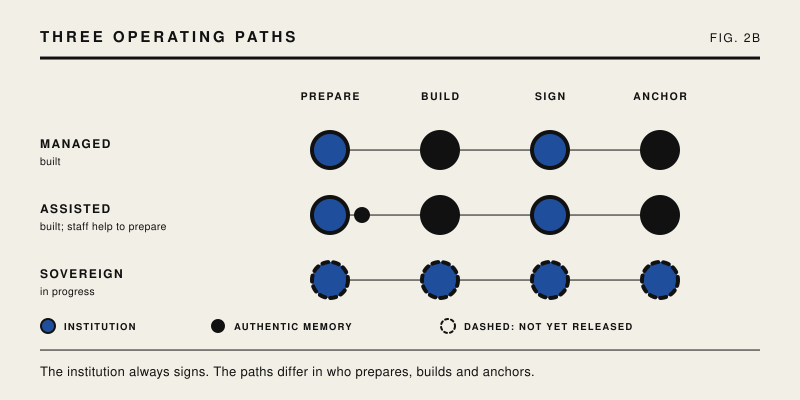

*Figure 2b. Who does each step on each path. Blue is the institution and black is Authentic Memory. On the assisted path Authentic Memory staff help to prepare. The sovereign path is dashed because it is not yet released.*

### 3.2 Frontend Architecture

- **Framework & Technologies:** React components inside the Next.js application, in TypeScript. Two hostnames serve one build: `app.authenticmemory.org` for the portal and `verify.authenticmemory.org` for the `/verify` route.
- **Key Design Patterns:**
  - **Cryptography in the browser where the secret or the file is.** The portal calls WebAuthn for signing. The verifier hashes the file in a Web Worker with `@noble/hashes` and sends only the hash.
  - **Ceremonies as guided components:** `add-device-ceremony`, `revoke-device-ceremony`, `webvh-identity-card`.
  - **Bulk work as panels over jobs:** `BulkImportPanel`, `UnsignedBatches`, `BulkSignPanel`.
- **Other user interfaces:**
  - gami-hash has a Wails GUI for Linux and macOS and a WPF GUI for Windows, both over the same Go engine.
  - The seal is an embed script, `badge.js`, loaded by an institution's catalogue page.
  - gami-cli-verifier renders results in the terminal through `src/output/render.ts` and returns one of three exit codes: success, failed or indeterminate.

### 3.3 Backend Architecture

- **Framework & Technologies:**
  - gami-app: Next.js API route handlers in TypeScript, NextAuth with stateless JWT sessions, `json-canonicalize` for JCS, `@otskit/client` for OpenTimestamps.
  - gami-verifiable-seal: a Hono service in TypeScript.
  - gami-hash: one Go module, `go 1.27.2`.
  - gami-cli-verifier: TypeScript, published on npm as `@authenticmemory/gami` and as standalone executables.
- **API Style:** REST-like JSON over HTTPS. There is no public API contract or version. The Submission API and a proof-status API are not built.
- **Route groups in gami-app** (all under `app/api/`):

| Group | Routes | Access |
|---|---|---|
| Records | `gprs`, `gprs/batch`, `gprs/batch-sign`, `gprs/[id]/yubikey-sign`, `gprs/[id]/stamp`, `gprs/batch-stamp`, `gprs/[id]/upgrade`, `gprs/upgrade-sweep` | Portal session |
| Bulk | `gprs/bulk-import`, `gprs/bulk-import/uploads`, `gprs/bulk-sign/claim`, `gprs/bulk-sign/[jobId]/submit`, `gprs/bulk-sign/[jobId]/stamp-retry` | Portal session |
| Download | `gprs/[id]/download`, `gprs/[id]/ots`, `gprs/batch-download` (ZIP, capped at 500 records) | Portal session or download token |
| Identity | `institution/webvh/genesis-info`, `log`, `update-key`, `hosting`, `revoke`, `upgrade`; `webauthn/register/*`, `webauthn/stepup/options` | Portal session, step-up |
| Admin | `admin/institutions`, `admin/users`, `settings` | Operator |
| Public | `public/verify`, `public/verify/chain`, `public/registry/record`, `public/stats` | No account |
| Cron | `cron/did-health` | Not scheduled by any deployment manifest |

- **Directory Structure Overview:**

| Repository | Layout |
|---|---|
| gami-app | `gami-webapp/src/app/` holds pages and API routes. `src/lib/` holds one folder per concern: `identity/`, `didwebvh/`, `bulk-import/`, `bulk-sign/`, `bulk-stamp/`, `ots/`, `jobs/`, `verify/`, `prf/`, `db/`. Single files cover the record builder (`gpr-builder.ts`), Merkle trees (`merkle.ts`), the registry (`registry.ts`) and the file store (`gpr-store.ts`). `gami-webapp/scripts/` holds operator scripts. |
| gami-hash | `internal/engine/` (walk, hash, resume, CSV contract), `cli.go`, `frontend/` (Wails), `windows/GamiHash.Windows/` (WPF and the AppContainer storage broker). |
| gami-cli-verifier | `src/commands/` (verify, inspect), `src/domain/` (canonical form, record validation, Merkle, signature, DID document, timestamp, Bitcoin), `src/adapters/` (did:webvh, Bitcoin network). |
| gami-verifiable-seal | `src/routes/` (script, badge), `src/lib/` (origin allow-list, read-only record query, validity). |
| gami-infra | Terraform, Ansible playbooks, Kustomize `base/` and `overlays/` for production and staging, ArgoCD. |

### 3.4 Component Responsibilities and State

| Component | Responsibility | State and stated gaps |
|---|---|---|
| **gami-hash** | Walk a folder tree in a fixed order, SHA-256 every file, write one CSV manifest and `_errors.log`. Resume only when path, size and modification time match. No network calls, read-only. | Built. The only software an institution is asked to install. Independent review pending. |
| **submission-format** | Define `manifest.json` plus `records.csv` or `records.xlsx`; ship templates and a dependency-free validator. | Built. `SPEC.md` and `gpr-schema.json` disagree on required fields. The portal has no package validator. |
| **Accounts and sign-in** | Passkey or magic-link sign-in; roles `realm-admin`, `gami-operator`, `signing-officer`. | Partial. Disabling a user blocks new sign-ins only; existing sessions are not revoked. |
| **Identity** | Create the did:webvh log with pre-rotation, enrol and revoke device keys, check that the institution hosts the current log. | Built for enrolment, history and publication. No recovery, witnesses or rotation reminders. No DID archive. |
| **Import pipeline** | Parse CSV and XLSX in several dialects, collapse repeated rows, build chunks through a resumable job. | Partial. All imported metadata becomes public; no disclosure step. No external Submission API. |
| **GPR builder** | Build one unsigned record per file hash; produce the signed form and the timestamp form. | Partial. No schema validation before signing. `parent` is written and never read. |
| **Signing** | Build the signing tree, bind the WebAuthn assertion to its root, write the signature and each record's path. | Built. Bulk imports are committed to the primary key, so the backup key cannot sign them. |
| **Timestamping** | Build the stamping tree, submit its root to OpenTimestamps calendars, upgrade pending proofs. | Partial. Calendar list is the library default. No overdue alert, no automatic resubmission, no second anchor. |
| **Job queue and worker** | Run import jobs and the hourly upgrade sweep; reconcile job rows with queued work. | Built. Queue technology and worker topology are not stated in the sources. |
| **Registry and store** | Hold records in PostgreSQL; look up by file hash; mirror each record to a JSON file. | Partial. The file store is not persisted in production. Records signed in test mode are publicly discoverable. |
| **Evidence export** | Per-record `.gpr.json` and `.ots`, ZIP bundles, emailed download tokens. | Partial. ZIP capped at 500 records. No self-contained evidence bundle. |
| **Verification engine** | Check file hash, Merkle inclusion, signature, key resolution and the OpenTimestamps proof. | Built, with one critical gap: `valid` is true on hash, signature and timestamp alone, whatever the key status. |
| **Public verifier** | Account-free pages and API for lookup by hash. | Partial. No bound on what one anonymous request can cost. |
| **gami-verifiable-seal** | Serve a badge to allow-listed origins, reading the gami-app database read-only. | Built. Shares the database with gami-app, so it shares its availability. |
| **gami-cli-verifier** | Verify a file and its record with no Authentic Memory service. Resolve the DID over HTTPS; read Bitcoin from a local node or two explorers that must agree. | Built. Has its own canonicaliser, with no test vectors shared with the portal. Offline mode reports Bitcoin membership as indeterminate. |
| **gami-local** | Build, sign, timestamp, export and verify on one workstation, loopback only. | In progress. Its README says it is not production-ready. |

## 4. Information/Data Viewpoint (ISO 42010)

*Addresses: Data structures, database systems, permanence, caching, and data flow.*

### 4.1 Data Architecture

Two models matter: the record the service writes today, and the Open Proof Record draft that is to replace it.

**As built: GPR v1 and the hosted store**

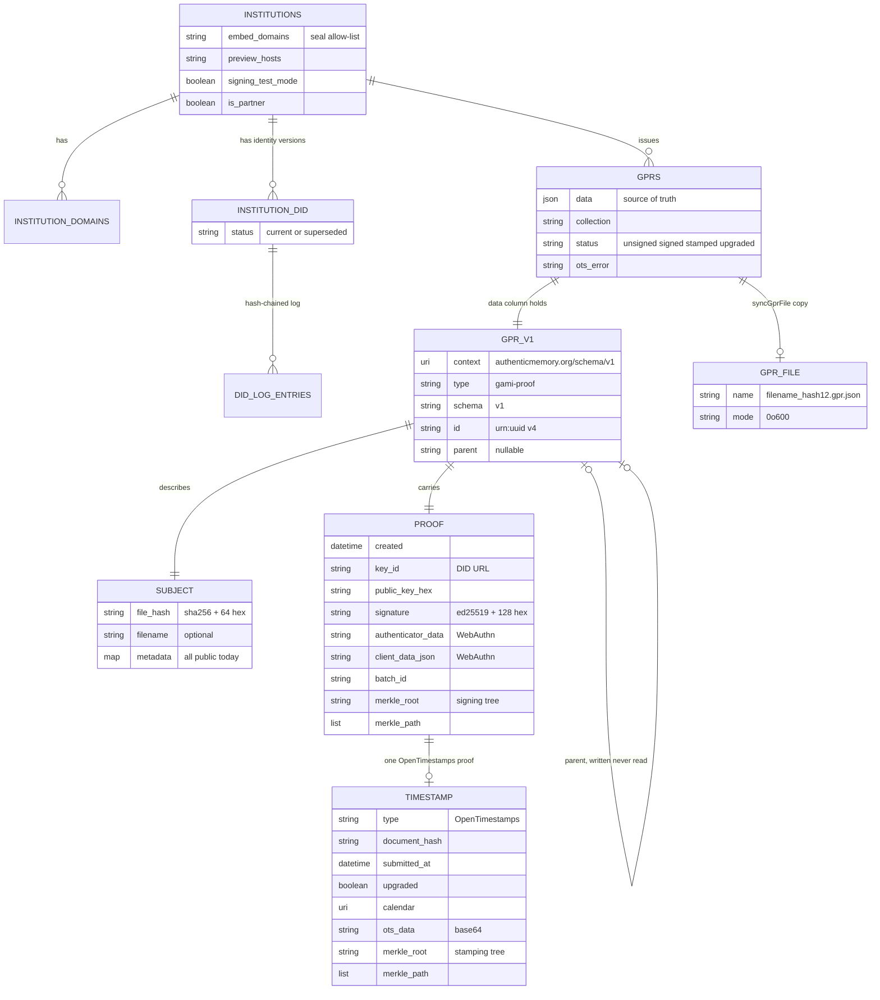

*Figure 3. Data as built. Table and column names are those named in the code mapping; tables for users, credentials, jobs and download tokens exist but are not named in the sources, and the relationship lines between tables are inferred.*

- The `gprs.data` column holds the whole record as a JSON string and is the source of truth. Downloads and ZIP bundles are read from it.
- The JSON file store is a derived copy, written by `syncGprFile()` after each state change and outside the database transaction.
- Three other dialects of "v1" appear in the documents: the published schema at `authenticmemory.org/schema/v1`, the CLI's reading, and the architecture description. They use different field paths. This is risk T-01, rated critical, and decision D-02.

**Two Merkle trees, three sets of bytes.** This is the part of the format most often misread.

| Step | Bytes | Result |
|---|---|---|
| Signed form | The record without the signature, WebAuthn data, batch fields and timestamp, serialised with JCS (RFC 8785) | SHA-256 gives the signing leaf |
| Signing tree | Leaves of one signing batch | Root is `proof.merkle_root` and is the WebAuthn challenge |
| Signature | `authenticator_data` followed by SHA-256 of `client_data_json` | Ed25519, stored as `ed25519:` plus 128 hex characters |
| Timestamp form | The signed record without its timestamp, serialised with JCS | SHA-256 gives the document hash |
| Stamping tree | Document hashes of one stamping batch | Root is the value sent to the anchors |

The stamping tree covers the signature; the signature does not cover the anchors. That is what lets a second anchor be added to records already signed.

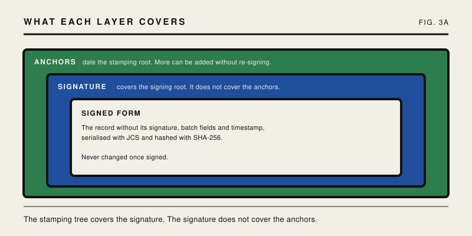

*Figure 3a. What each layer covers. The signed form is fixed, the signature covers it, and the anchors cover both and can be added to.*

**Target: Open Proof Record 2.0.2 (working draft, not implemented)**

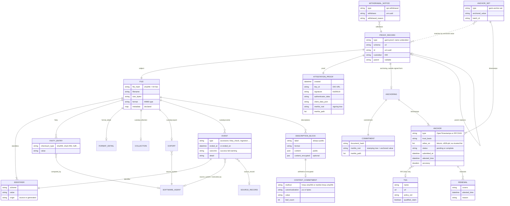

*Figure 4. Entities of the Open Proof Record 2.0.2 draft. Attribute lists are abridged to the fields that carry the design.*

What the draft changes:

| Area | v1 as built | OPR 2.0.2 draft |
|---|---|---|
| Anchors | One `proof.timestamp`, OpenTimestamps only | Top-level `anchoring` with one `commitment` and a list of typed `timestamps`, each naming its trust basis and what it relies on |
| Custody | None | `custodian` required; file `identifiers` required; optional collection, export and events imported from the source system |
| Fixity | One `file_hash` string | `file_hash` kept, plus a `fixity` list in PREMIS form that can carry several algorithms |
| Description | Flat string map, all public | Description blocks, each public, encrypted (JWE) or withheld behind a salted HMAC-SHA-256 commitment |
| Correction | `parent` written, never read | `parent` names the replaced record; a separate signed withdrawal notice |
| Old records | Not applicable | A v1 batch gets its second anchor in a separate anchor-set file that names the batch's stamped root |
| Vocabulary | A `gami:` context that does not match the code | A JSON-LD 1.1 context mapping every key to PROV-O, PREMIS 3, Dublin Core, the W3C security vocabulary or `opr:` |

**Vocabulary layers.** PROV-O supplies entity, activity and agent. PREMIS 3 with the Library of Congress vocabularies and Dublin Core supplies file, event, fixity, identifier and collection. The `opr:` namespace adds only record, proof, commitment and anchor. C2PA is not a layer: a manifest is evidence a record may refer to by hash. Verification works on the JSON bytes and must not depend on JSON-LD processing.

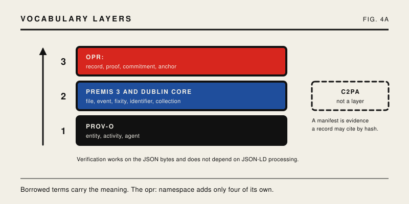

*Figure 4a. The vocabulary layers of the Open Proof Record draft. C2PA stands beside the stack and is not part of it.*

**Other data objects**

| Object | Form | Holder |
|---|---|---|
| Hash manifest | CSV from gami-hash: filename, relative path, size, modification time, source record identifier, file hash | Institution |
| Submission package | `manifest.json` plus `records.csv` or `records.xlsx` | Institution, then portal |
| DID log | `did.jsonl`, hash-chained, with pre-rotation commitments; legacy `did.json` | Institution domain; a copy in `did_log_entries` |
| Wrapped update key | Update-key seed wrapped with the hardware key's PRF secret, one ciphertext per device | Portal database |
| Detached timestamp | `.ots` file | Portal, institution |
| Evidence ZIP | Up to 500 stamped records | Institution |

### 4.2 Database Decisions

- **Primary Database:** PostgreSQL ([ADR-014](./Software-dev/V1/V1%20ADRs/ADR-014-postgresql-gpr-index-and-file-store.md)), keyed for lookup by the 64-character file hash. In production it runs as a cluster defined in `gami-infra` and is the only durable copy of the records.
- **Schema Management:** tables are defined in `gami-webapp/src/lib/db/schema.ts`. The migration tool is not stated in the sources.
- **Caching Strategy:** no cache layer. DID resolution is cached inside the verification engine. The rate limiter keeps its counters in process memory.
- **Secondary store:** the JSON file store under `GPR_STORE_DIR`, one file per record named `{filename}_{first 12 characters of the hash}.gpr.json`, mode `0o600`. Persistent in staging; not persisted in production.
- **Retention:** records are meant to be permanent. A log retention schedule and exit terms are not defined.
- **Sizing (design estimates, not measured):** 1 to 3 KB per v1 record; 10 to 30 GB per 10 million records. A v2 record with two RFC 3161 tokens should stay under 24 kB.

### 4.3 What a Record Proves

| Claim | Evidence in the record | Limit |
|---|---|---|
| Integrity | SHA-256 of the file | Exact bytes only; a re-encoded copy does not match |
| Attestation | Ed25519 signature by a key in the custodian's DID log | The link from key to institution rests on control of a domain |
| Inclusion | The two Merkle paths | None |
| Existence in time | Each anchor | A lower bound: no later than the attested time |
| Custody history and description | Declared by the custodian and signed | Declared, not verified |

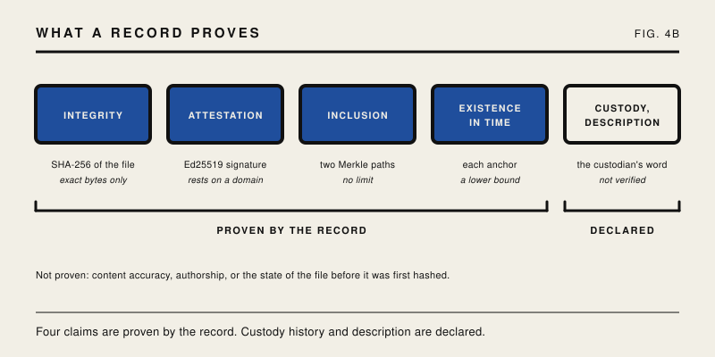

*Figure 4b. What a record proves. Each claim is shown with its evidence and, in italics, its limit.*

## 5. Deployment/Physical Viewpoint (ISO 42010)

*Addresses: How the logical components are mapped onto physical hardware, cloud instances, or container networks.*

### 5.1 Infrastructure Architecture

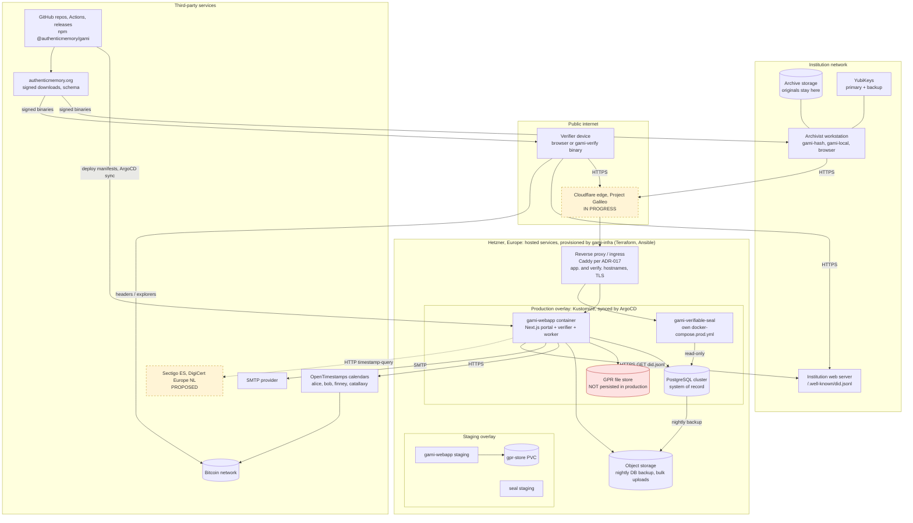

*Figure 5. Deployment as evidenced by gami-infra, with the documented proxy and hosting choices. Red marks a store that does not survive a restart; dashed elements are proposed or in progress.*

| Node | Runs | Notes |
|---|---|---|
| Institution workstation | gami-hash, a browser, later gami-local | gami-hash builds exist for Windows and Linux; a Wails GUI targets Linux and macOS, although no macOS release is listed. |
| Institution web server | `/.well-known/did.jsonl` and `did.json` | Publishing depends on the institution's IT. A fallback location while it is unpublished is undecided. |
| Hosted production | The `gami-webapp` container, a PostgreSQL cluster, the seal | Hetzner, Europe ([ADR-018](./Software-dev/V1/V1%20ADRs/ADR-018-hetzner-european-hosting.md)). The seal deploys from its own `docker-compose.prod.yml`. |
| Hosted staging | The same application with a persistent `gpr-store` volume; the seal | Staging keeps the file store; production does not. |
| Object storage | Nightly database backup; direct-to-bucket bulk uploads | Provider not stated. Point-in-time recovery is documented in `gami-infra/docs/database.md`. A restore has not been tested. |
| Edge | Caddy for TLS and logging ([ADR-017](./Software-dev/V1/V1%20ADRs/ADR-017-docker-compose-caddy-deployment.md)); Cloudflare Project Galileo in front | Cloudflare is about 95% done and is not evidenced in the code mapping. |
| Third parties | OpenTimestamps calendars, Bitcoin, an SMTP provider, GitHub | Authentic Memory runs no calendar and no Bitcoin node, and holds no cryptocurrency. |

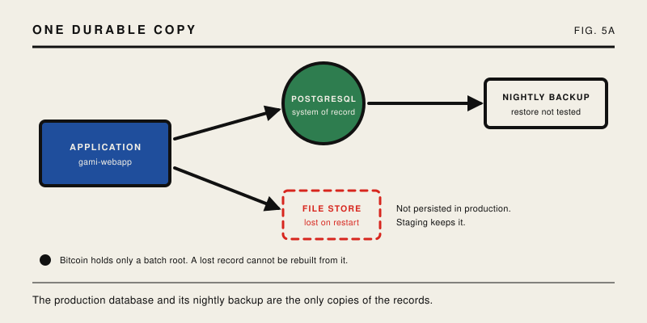

*Figure 5a. Where the records are kept in production. The file store does not survive a restart, so the database and its nightly backup are the only durable copies.*

**The deployment decision needs reconciling.** ADR-017 and the technical stack describe docker-compose behind Caddy on a single host. `gami-infra` contains Terraform, Ansible, Kustomize overlays, ArgoCD and a PostgreSQL cluster manifest, which is a Kubernetes-style deployment. The diagram shows both, because the sources do not say which serves production traffic today. See [section 10](#10-conflicts-gaps-and-risks).

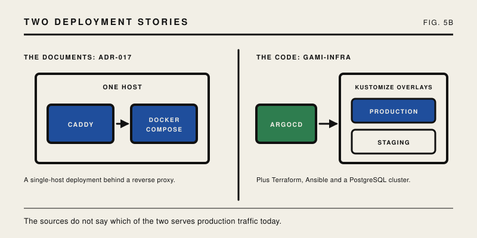

*Figure 5b. The deployment the documents describe, and the deployment the code in gami-infra describes.*

### 5.2 CI/CD Pipeline

- **Orchestration / Tooling:** GitHub for source, review and releases ([ADR-019](./Software-dev/V1/V1%20ADRs/ADR-019-github-source-and-releases.md)); ArgoCD syncing Kustomize overlays; Terraform and Ansible for hosts; a separate workflow for the seal.
- **Current Pipeline Stages:** not documented in the sources. What is known:
  - Tool releases flow from GitHub to authenticmemory.org as signed downloads with published checksums.
  - gami-cli-verifier builds standalone executables with `scripts/build-standalone.mjs` and publishes to npm.
  - gami-app has no committed lockfile, so installs are not reproducible.
  - Schema validation of records in CI is planned, not built.
  - Seventeen security-fix pull requests were open for review in gami-app.

## 6. Security Viewpoint (ISO 42010)

*Addresses: Threat vectors, authentication boundaries, and data protection mechanisms.*

### 6.1 Authentication Flow

Two things are authenticated and they are kept apart: the person signing in, and the institution signing a batch. A stolen session cannot produce an institutional signature, because signing needs the hardware key, its PIN and a touch.

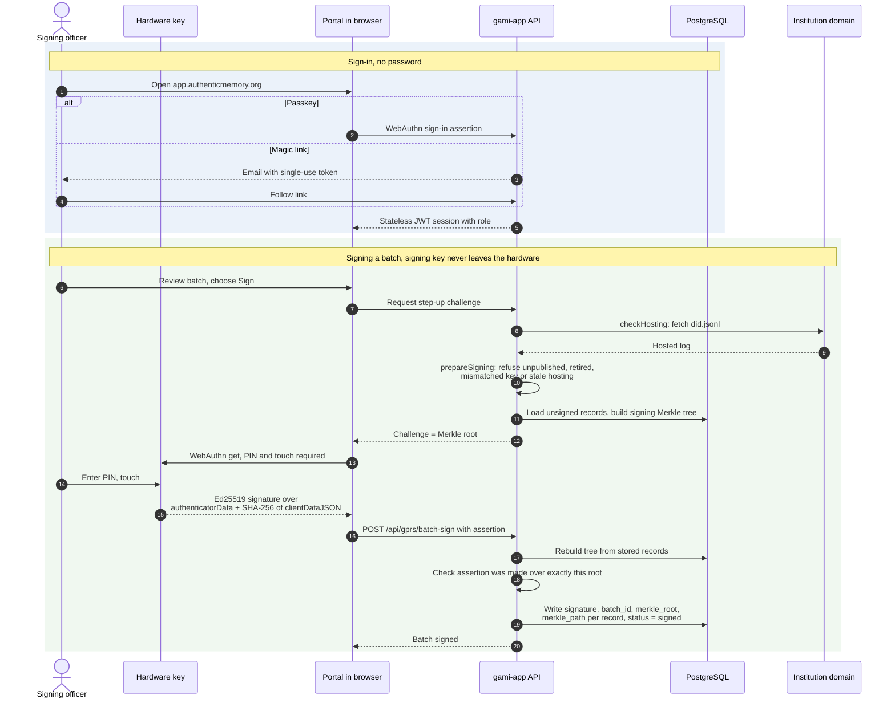

*Figure 6. Sign-in and batch signing. The Merkle root of the batch is the WebAuthn challenge, so one touch covers every record in the batch.*

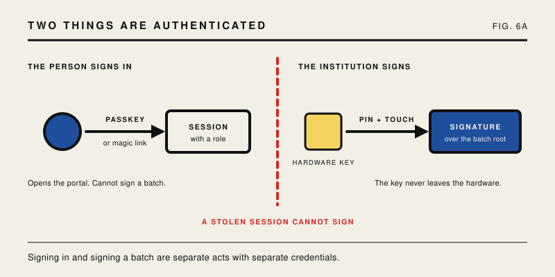

*Figure 6a. The two authentications of Figure 6, reduced to their credentials and results.*

Verification is the second trust flow. It needs no authentication at all.

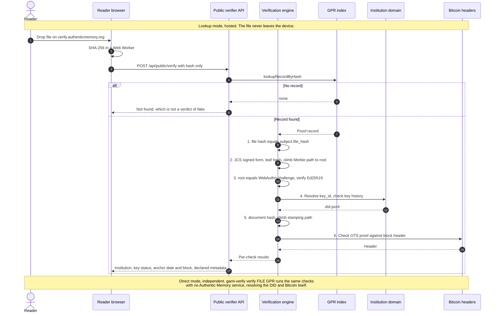

*Figure 7. Verification in lookup mode through the hosted verifier, and in direct mode with the independent CLI.*

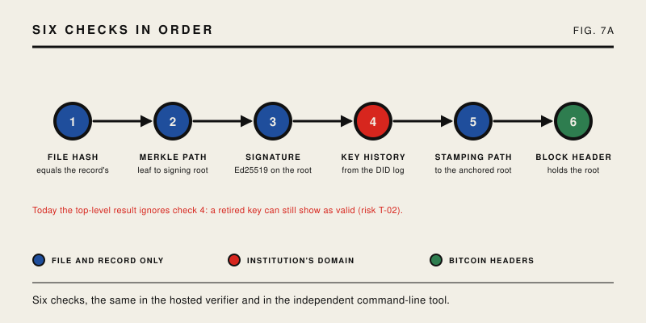

*Figure 7a. The six checks of Figure 7 and what each one needs. Check 4 is red because the top-level result does not depend on it today (risk T-02).*

### 6.2 Security Measures

- **Secrets Management:**
  - Institutional signing keys are Ed25519 WebAuthn credentials generated on a hardware key, with a primary and a backup. They never leave it and Authentic Memory never holds them.
  - The did:webvh update key is wrapped with the hardware key's PRF secret, one ciphertext per device.
  - Server secrets (database, SMTP, session signing) are not described in the sources.
  - Release signing keys protect the tool downloads; hardware-backed release keys are recommended, not confirmed.
- **Network Boundaries:**
  - gami-hash makes no network connections. gami-local listens on loopback only.
  - The public verifier and the portal are one application on two hostnames, so they share a failure domain and an attack surface.
  - The seal checks the browser's `Origin` against each institution's allow-list and has read-only database access.
- **Trust boundaries and what protects each:**

| Boundary | Control | State |
|---|---|---|
| Person to portal | Passkey or single-use magic link; three roles; step-up with PIN and touch | Built. Session revocation is a no-op. |
| Institution to record | Signature bound to the exact batch root; signing refused for unpublished, retired or mismatched keys and for stale hosting | Built |
| Key to institution | did:webvh log on the institution's domain, with a self-certifying identifier and pre-rotation | Built. Witnesses and recovery are not built. Lookalike domains are an open issue. |
| Record to time | OpenTimestamps proof against Bitcoin block headers | Built. A second anchor is proposed. |
| Verifier result to reader | Per-check results | Partial. The top-level `valid` ignores key status (risk T-02, critical). |
| Tool to institution | Signed releases; no network; read-only | Built. SBOM and network documentation are due at gate G1. |

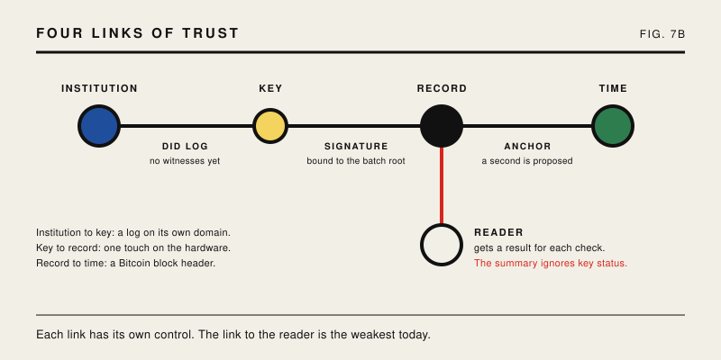

*Figure 7b. Four of the trust boundaries in the table above, drawn as links. The link from the verifier result to the reader is red because of risk T-02.*

- **Privacy:**
  - No content is stored. Public records still disclose holdings, since anyone with a file can confirm an institution holds it.
  - All imported metadata is public today. A per-column choice before signing is designed in the [UX mockup](../requirements/UX-requirements-am-portal-mockup-pablo-nov.html); withheld and encrypted blocks are in the v2 draft.
  - Proxy and edge logs can reveal who checked which file. No retention schedule exists.
- **Cryptographic lifetime:**
  - Ed25519 is not quantum-safe. The anchor date bounds the damage, because a later forgery cannot be placed in an earlier block.
  - A renewal chain (re-hash with SHA-3, sign with SLH-DSA, re-anchor every 3 to 5 years) is a documented design with a prototype due 30 April 2027.
  - Qualified time-stamps add a standing duty: they must be renewed before the signer's certificate expires.
- **Open review findings:** an internal review of the portal and verifier left 3 critical, 10 high and 7 medium findings open, covering signing authorisation, key management, sessions, input handling, outbound requests, logging and result semantics. An external audit is committed for 30 April 2027.

## 7. Performance & Concurrency Viewpoint (ISO 42010)

*Addresses: Scalability, error handling, rate limiting, and system observation mechanisms.*

A record moves through four built states. Signing is synchronous and takes one touch. Anchoring is asynchronous: submission takes seconds, confirmation takes hours.

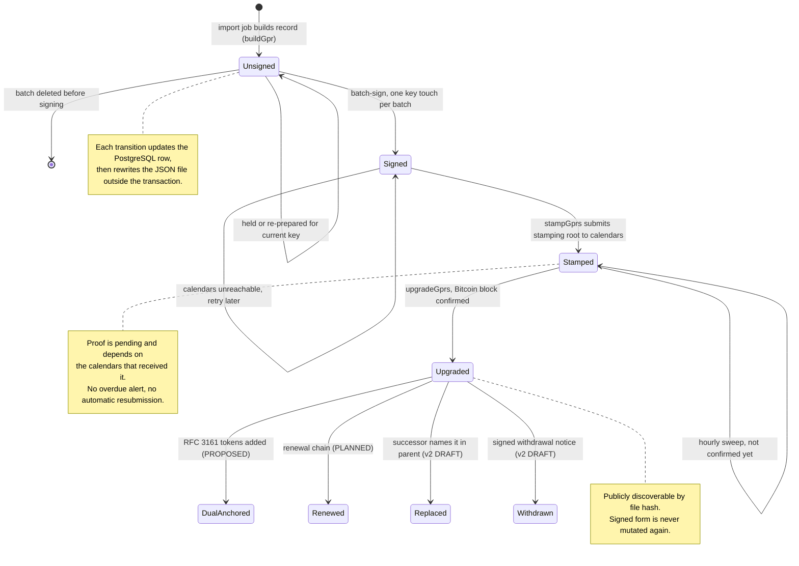

*Figure 8. Record states. The four states down to Upgraded are built; the four below it are proposed, planned or draft.*

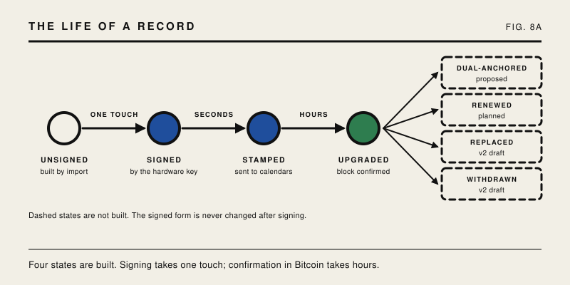

*Figure 8a. The states of Figure 8 with the time each step takes. Dashed states are proposed, planned or draft.*

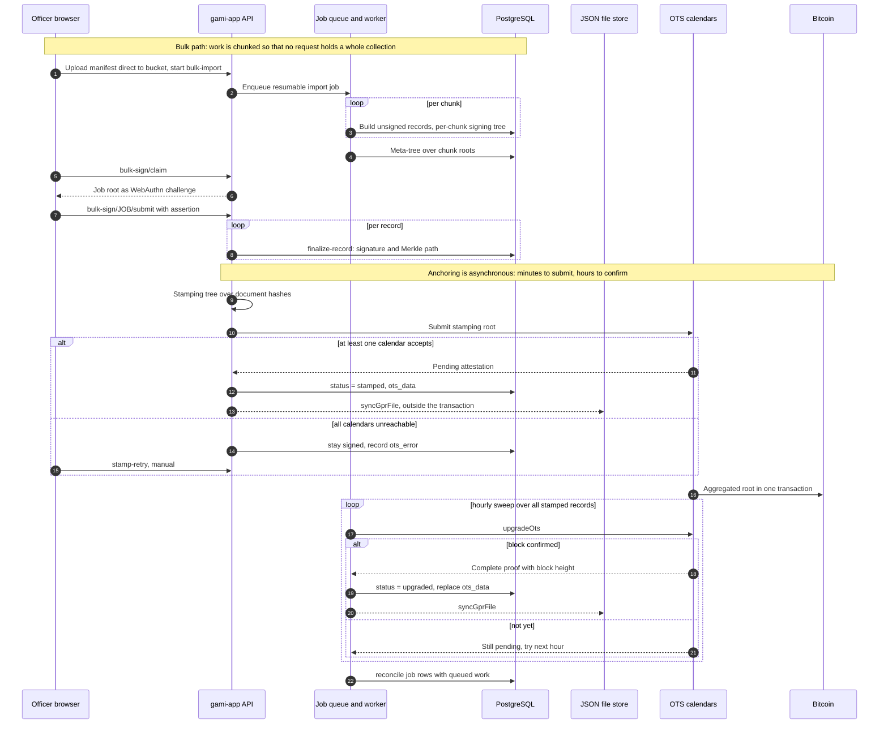

*Figure 9. The bulk path and the anchoring loop: chunked import, claim-then-submit signing, and the hourly sweep that upgrades pending proofs.*

### 7.1 Scalability Constraints

- **Known Bottlenecks:**

| Bottleneck | Effect |
|---|---|
| One application serves portal, verifier and worker | Load or attack on the public verifier reaches the signing portal |
| Anonymous verify requests are unbounded | One request can trigger DID resolution and Bitcoin checks at the service's cost |
| Rate limiter is in memory, per process, and never frees keys | Memory grows without limit; limits do not hold across processes |
| File write is outside the database transaction | A crash leaves the file copy one state behind |
| Pending proofs depend on the calendars that received them | If every such calendar fails before upgrade, the batch must be stamped again with a later date |
| Bulk download capped at 500 records | Large exports must be chunked by hand |
| Browser hashing shows a 4 GB limit | Not load-tested |
| Hardware-key signing needs a person | Throughput per institution is bounded by batches, not records |

- **Mitigation:**
  - **Built:** Merkle batching makes signing and anchoring cost independent of batch size. Imports are chunked and resumable. Bulk signing uses claim then submit. The hourly sweep retries until a block confirms. One institution has signed 552,897 records in test mode.
  - **Committed:** a 1,000,000-record load test by 31 January 2027; a redundant public verifier with mirrors by 30 April 2027.
  - **Not started:** an overdue-proof alert, automatic resubmission, a bound on anonymous request cost, an own calendar (estimated at €10k a year).
- **Design estimates, none measured:** hash lookup under 1 ms at 100 million records; signature check under 1 ms; SHA-256 at about 500 MB/s per core.
- **Timing of each anchor type:**

| Anchor | Latency | Precision | State |
|---|---|---|---|
| OpenTimestamps and Bitcoin | A few hours to confirm | Block time, about two hours | Built |
| Qualified RFC 3161 token | One synchronous HTTP request per provider per batch | One second or better | Proposed |

  Expected volume is a few batch roots a day, so the anchors are not a throughput concern.

### 7.2 Observability & Monitoring

- **Logging Subsystems:** Caddy access logs. Per-record `ots_error` in the database. An operator page for bulk jobs at `dashboard/admin/bulk-jobs`. A diagnostic script, `diagnostics/verify-census.ts`.
- **Tracing / Alerting:** none found. A `cron/did-health` endpoint exists, covers legacy did:web only and is not scheduled. There is no alert for overdue pending proofs and no completeness audit that everything submitted was signed, anchored and published.

## 8. Technology Decisions Summary

| Layer | Technology | Rationale (Driven by ADRs) |
|---|---|---|
| Architecture Style | Post-ingestion, read-only layer; one hosted monolith plus offline tools | Privacy, petabyte collections and a small security-review surface. [ADR-009](./Software-dev/V1/V1%20ADRs/ADR-009-read-only-post-ingestion-integration.md), [ADR-012](./Software-dev/V1/V1%20ADRs/ADR-012-nextjs-typescript-react-web-app.md) |
| File fingerprint | SHA-256, computed locally or reused from fixity records | Shared with OpenTimestamps, C2PA and preservation systems. [ADR-003](./Software-dev/V1/V1%20ADRs/ADR-003-sha256-file-fingerprint.md) |
| Hashing tool | gami-hash in Go, offline and read-only | A single auditable binary with no route into or out of the archive. [ADR-011](./Software-dev/V1/V1%20ADRs/ADR-011-gami-hash-go-offline-tool.md) |
| Submission | gami-submit-1.0 manifests with a dependency-free validator | Spreadsheets are the lowest common denominator. [ADR-010](./Software-dev/V1/V1%20ADRs/ADR-010-gami-submit-manifest-format.md) |
| Signature | Ed25519 | Compact, widely implemented, supported by hardware keys. [ADR-004](./Software-dev/V1/V1%20ADRs/ADR-004-ed25519-institutional-signatures.md) |
| Signing mechanism | WebAuthn on institution-held hardware keys; Merkle-root batch signing | The key never leaves hardware; one touch signs a batch. [ADR-005](./Software-dev/V1/V1%20ADRs/ADR-005-hardware-key-webauthn-signing.md) |
| Canonical form | JCS, RFC 8785 | Deterministic bytes for free-form metadata. [ADR-007](./Software-dev/V1/V1%20ADRs/ADR-007-jcs-canonicalization.md) |
| Identity | did:web moving to did:webvh on the institution's domain | The institution is its own trust root, with verifiable key history. [ADR-008](./Software-dev/V1/V1%20ADRs/ADR-008-did-web-institutional-identity.md) |
| Proof record | Self-contained JSON, GPR schema v1 | Verifiable without any service. [ADR-006](./Software-dev/V1/V1%20ADRs/ADR-006-gami-proof-record-format.md) |
| Time anchor | Bitcoin through OpenTimestamps calendars | Public, permissionless, no maintaining authority. [ADR-001](./Software-dev/V1/V1%20ADRs/ADR-001-bitcoin-blockchain-time-anchor.md), [ADR-002](./Software-dev/V1/V1%20ADRs/ADR-002-opentimestamps-anchoring.md) |
| Second anchor | eIDAS-qualified RFC 3161 time-stamps from two providers | Fails independently of Bitcoin and has legal effect. Proposed in [ADR-RFC3161](./ADRs/ADR-RFC3161.md) |
| Frontend | React in Next.js, TypeScript | One language across browser and server for a small team. [ADR-012](./Software-dev/V1/V1%20ADRs/ADR-012-nextjs-typescript-react-web-app.md) |
| Backend | Next.js API route handlers | One deployable. [ADR-012](./Software-dev/V1/V1%20ADRs/ADR-012-nextjs-typescript-react-web-app.md) |
| Authentication | NextAuth with JWT sessions, passkeys and magic links | No passwords; signing authority bound to hardware. [ADR-013](./Software-dev/V1/V1%20ADRs/ADR-013-nextauth-passkey-magic-link-auth.md) |
| Database | PostgreSQL plus a JSON file store | A hash lookup is a B-tree query. [ADR-014](./Software-dev/V1/V1%20ADRs/ADR-014-postgresql-gpr-index-and-file-store.md) |
| Verifier hashing | In the reader's browser; only the hash is sent | The file stays on the device. [ADR-015](./Software-dev/V1/V1%20ADRs/ADR-015-client-side-browser-hashing.md) |
| Independent verifier | gami-cli-verifier | Takes Authentic Memory out of the verification path. [ADR-016](./Software-dev/V1/V1%20ADRs/ADR-016-independent-cli-verifier.md) |
| Deployment | Docker, docker-compose, Caddy | Reproducible single-host deployment. [ADR-017](./Software-dev/V1/V1%20ADRs/ADR-017-docker-compose-caddy-deployment.md). Conflicts with `gami-infra`; see section 10. |
| Hosting | Hetzner | Preference for European services. [ADR-018](./Software-dev/V1/V1%20ADRs/ADR-018-hetzner-european-hosting.md) |
| Source and releases | GitHub, signed downloads | Public, inspectable code. [ADR-019](./Software-dev/V1/V1%20ADRs/ADR-019-github-source-and-releases.md) |
| Licences | MIT for tools, CC0 for the submission format; Apache 2.0 due for Google.org-funded work | Removes barriers to audit and reimplementation. [ADR-020](./Software-dev/V1/V1%20ADRs/ADR-020-open-source-licensing.md) |

## 9. Architecture Decision Records

The project rule in [iso-42010-adr.md](../.agents/kb/iso-42010-adr.md) requires nine information items in every ADR: Title, Status, Context, Decision, Rationale, Assumptions, Alternatives Considered, Consequences and Related Decisions. This section checks the existing records against that rule and lists the decisions that have no record.

### 9.1 Conformance of Existing ADRs

All 21 records were checked for the nine section headings. All 21 carry all nine. The decisions themselves are summarised in section 8; the last column says whether the code agrees.

| ADR | Status | Nine items | Agrees with code |
|---|---|---|---|
| [ADR-001](./Software-dev/V1/V1%20ADRs/ADR-001-bitcoin-blockchain-time-anchor.md) Bitcoin time anchor | Accepted | Yes | Yes |
| [ADR-002](./Software-dev/V1/V1%20ADRs/ADR-002-opentimestamps-anchoring.md) OpenTimestamps | Accepted | Yes | Partly. "Multiple calendars with automatic retry" is a library default plus a sweep; nothing resubmits. |
| [ADR-003](./Software-dev/V1/V1%20ADRs/ADR-003-sha256-file-fingerprint.md) SHA-256 | Accepted | Yes | Yes. Reuse of existing fixity has no code. |
| [ADR-004](./Software-dev/V1/V1%20ADRs/ADR-004-ed25519-institutional-signatures.md) Ed25519 | Accepted | Yes | Yes |
| [ADR-005](./Software-dev/V1/V1%20ADRs/ADR-005-hardware-key-webauthn-signing.md) WebAuthn signing | Accepted | Yes | Yes |
| [ADR-006](./Software-dev/V1/V1%20ADRs/ADR-006-gami-proof-record-format.md) GPR v1 | Accepted | Yes | No. The fields it lists (`private_hash`, `timestamps` array, `metadata.public`) are the documented dialect, not the record the code writes. |
| [ADR-007](./Software-dev/V1/V1%20ADRs/ADR-007-jcs-canonicalization.md) JCS | Accepted | Yes | Yes. The ADR's doubt is resolved: the portal uses `json-canonicalize`. Two separate canonicalisers still lack shared test vectors. |
| [ADR-008](./Software-dev/V1/V1%20ADRs/ADR-008-did-web-institutional-identity.md) did:web and did:webvh | Accepted | Yes | Partly. Pre-rotation is built. The DID archive fallback is not. |
| [ADR-009](./Software-dev/V1/V1%20ADRs/ADR-009-read-only-post-ingestion-integration.md) Read-only integration | Accepted | Yes | Yes |
| [ADR-010](./Software-dev/V1/V1%20ADRs/ADR-010-gami-submit-manifest-format.md) gami-submit-1.0 | Accepted | Yes | Partly. The portal accepts tables but does not validate the package. |
| [ADR-011](./Software-dev/V1/V1%20ADRs/ADR-011-gami-hash-go-offline-tool.md) gami-hash | Accepted | Yes | Yes. The ADR says no macOS build; the code has a Wails GUI for macOS. |
| [ADR-012](./Software-dev/V1/V1%20ADRs/ADR-012-nextjs-typescript-react-web-app.md) Next.js application | Accepted | Yes | Yes |
| [ADR-013](./Software-dev/V1/V1%20ADRs/ADR-013-nextauth-passkey-magic-link-auth.md) NextAuth | Accepted | Yes | Partly. The code has no `editor` role; roles are `realm-admin`, `gami-operator`, `signing-officer`. |
| [ADR-014](./Software-dev/V1/V1%20ADRs/ADR-014-postgresql-gpr-index-and-file-store.md) PostgreSQL and file store | Accepted | Yes | Partly. The file store is not persisted in production. |
| [ADR-015](./Software-dev/V1/V1%20ADRs/ADR-015-client-side-browser-hashing.md) Browser hashing | Accepted | Yes | Partly. The code uses `@noble/hashes` in a Web Worker, not the Web Crypto API. |
| [ADR-016](./Software-dev/V1/V1%20ADRs/ADR-016-independent-cli-verifier.md) GAMI Verify | Accepted | Yes | Yes |
| [ADR-017](./Software-dev/V1/V1%20ADRs/ADR-017-docker-compose-caddy-deployment.md) docker-compose and Caddy | Accepted | Yes | No. `gami-infra` shows Kustomize, ArgoCD and a PostgreSQL cluster. |
| [ADR-018](./Software-dev/V1/V1%20ADRs/ADR-018-hetzner-european-hosting.md) Hetzner | Accepted | Yes | Not evidenced in code either way |
| [ADR-019](./Software-dev/V1/V1%20ADRs/ADR-019-github-source-and-releases.md) GitHub | Accepted | Yes | Yes |
| [ADR-020](./Software-dev/V1/V1%20ADRs/ADR-020-open-source-licensing.md) Licensing | Accepted | Yes | Partly. gami-app is not listed as public. |
| [ADR-RFC3161](./ADRs/ADR-RFC3161.md) Second anchor (proposed ADR-021) | Proposed | Yes | Not built |

Defects in the records themselves:

1. **Location.** The rule places ADRs in `resources/architecture/ADRs/`. The 20 accepted records sit in `reports/Software-dev/V1/V1 ADRs/`. A second folder, [reports/ADRs/](./ADRs/), holds the proposed ADR-021 and, as of 27 November 2026, a renumbered copy of the Bitcoin decision, [ADR-010](./ADRs/ADR-010-bitcoin-blockchain-time-anchor.md).
2. **A renumbering is half done.** ADR-001 in the V1 folder already calls itself ADR-010 on its second line and links to `ADR-020-opentimestamps-anchoring.md` and `ADR-030-sha256-file-fingerprint.md`, which do not exist yet. Every other record still uses and links the 001 to 020 numbers. The new ADR-010 copy opens with "Description" where the rule requires "Title".
3. **Broken context links.** The 20 ADRs link to 16 documents that are not in this repository, among them the risk register, the system overview, the system requirements and the system workflow. Their Context and Rationale sections cannot be followed to source here.
4. **ADR-RFC3161 names itself `2nd-anchor-ADR.md`** and links to sibling files as if it were inside `Anchoring-alternatives/`. Those links do not resolve from `reports/ADRs/`.
5. **Inferred rationale.** ADR-011, 012, 013, 014, 017, 018 and 019 state that their rationale was not recorded and is inferred. Seven of twenty decisions have no recorded reason.

### 9.2 Decisions in Use Without an ADR

These technologies and choices are in the code or the drafts with no record of the decision.

| Decision in use | Where | Why it needs a record |
|---|---|---|
| Kustomize, ArgoCD, Terraform and Ansible for deployment | gami-infra | Contradicts ADR-017 |
| A separate seal service on Hono with direct read access to the portal database | gami-verifiable-seal | New service, new framework, shared database |
| A job queue and worker inside the application | gami-app `lib/jobs/` | Technology not even named in the sources |
| Object storage for bulk uploads and backups | gami-app, gami-infra | Third-party dependency holding institutional data |
| Wails and WPF for the gami-hash GUIs, and an AppContainer broker | gami-hash | Two GUI stacks to maintain |
| Wrapping the DID update key with the hardware key's PRF secret | gami-app `lib/prf/` | A key-management design |
| Two Merkle trees per batch, and a meta-tree for bulk | gami-app | Central to the proof contract, described only in drafts |
| `@noble/hashes`, `json-canonicalize`, `@otskit/client` | gami-app | Cryptographic dependencies on the validity path |
| Bitcoin read from a local node or two agreeing explorers | gami-cli-verifier | A trust decision in the independent verifier |
| Open Proof Record v2 as successor to GPR v1, and its name | Drafts | ADR-006 needs a successor; ADR-RFC3161 already depends on it |
| PROV-O, PREMIS 3 and Dublin Core as the vocabulary layers | OPR drafts | Binds the format to three external standards |
| Withheld and encrypted metadata blocks | OPR drafts | Privacy design with long-lived salts and keys |
| gami-local as a separate product for the sovereign path | gami-local | A second implementation of build, sign and stamp |

## 10. Conflicts, Gaps and Risks

### 10.1 Where the Documents and the Code Disagree

| Topic | Documents say | Code shows |
|---|---|---|
| Deployment | docker-compose and Caddy on one host | Kustomize overlays, ArgoCD, a PostgreSQL cluster |
| File store | Live store of JSON records | Lost on every production restart |
| Roles | Operator, signing officer, editor | `realm-admin`, `gami-operator`, `signing-officer` |
| Browser hashing | Web Crypto API | `@noble/hashes` in a Web Worker |
| Key technology | "YubiKey (PIV)" | WebAuthn Ed25519 credentials with PRF |
| Calendars | Multiple calendars with automatic retry | Library default list; a sweep; no resubmission |
| Public API | Rate-limited | No bound on anonymous verify cost |
| Record fields | `subject.hash`, `institution`, `timestamps[]`, `id` as a content hash | `subject.file_hash`, `proof.key_id`, one `proof.timestamp`, `id` as a UUID |
| Verifier version | 0.4.1 | 0.4.3 in the issue report |
| Backup key for bulk signing | Primary only | The current modal offers primary or backup; issue 230 says bulk imports are bound to the primary |
| Seal | An iframe served by the verifier | A separate Hono service with `badge.js` |

### 10.2 Critical Risks from the Register

| Risk | Statement | Architectural consequence |
|---|---|---|
| T-01 | The proof contract is not frozen: four sources, different field paths, hex against Base64 | No independent verifier can be written against a specification. Blocks the open standard due 31 Dec 2026. |
| T-02 | The verifier's top-level result does not depend on key authorisation | A record signed by a retired or unconfirmed key can show as valid |
| T-08 | A second timestamping system is not in production | All time evidence shares one failure mode. Committed for 31 Dec 2026. |
| T-15 | Key custody is failing in practice | The trust model rests on a procedure institutions do not follow |
| T-22 | 3 critical and 10 high review findings open | Shared attack surface of portal and verifier |

### 10.3 Structural Gaps

- **Function 9 has no component.** Corrections, withdrawal, version links, renewal, completeness audit, dispute handling and succession exist only as drafts or operator scripts.
- **One durable copy.** With the file store ephemeral and no mirrors, the production database and its nightly backup are the only copies Authentic Memory holds. A lost record cannot be rebuilt from Bitcoin, which holds only a root.
- **No specification, PRD or SRS.** The stack has decisions and code without the requirement documents that should connect them.
- **Eleven mapped gaps have no issue**, including the single-record stamp route that marks a record stamped without checking `ots_error`.
- **Funding ends in April 2027**, the same month as the external audit, the renewal prototype and the redundant verifier.

### 10.4 Committed Changes to the Architecture

| Date | Change | Viewpoints affected |
|---|---|---|
| Gate G1, Oct–Nov 2026 | Freeze the proof contract; gate the verifier result on key authorisation; publish SBOM and network documentation | Data, Security |
| 31 Dec 2026 | Second anchor in production; widget released; open standard v1.0; metadata privacy; Apache 2.0 relicensing | Data, Logical, Concurrency |
| 31 Jan 2027 | Submission API; connectors; 1,000,000-record load test | Logical, Concurrency |
| 30 Apr 2027 | External audit; renewal prototype; redundant verifier with mirrors; C2PA export proof of concept | Security, Deployment |
| Not dated | Sovereign toolchain; proof-status API and MCP server; transparency log; AT Protocol publication | Context, Logical |

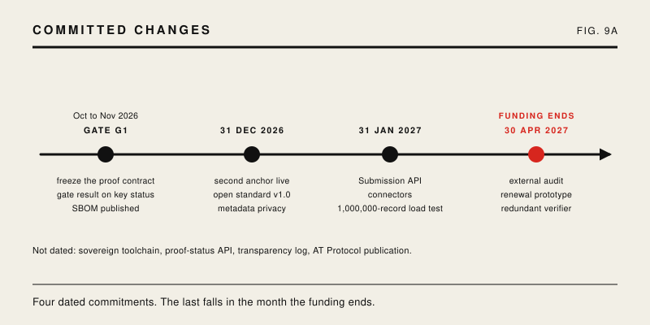

*Figure 9a. The committed changes on a time line. A selection of the items in the table above.*

## Appendix A. Source Coverage

| Folder | How it was read |
|---|---|
| `references/AuthenticMemory/` | All 14 files read in full, plus the UX mockup in `requirements/`. |
| `references/GPR/` | The 2.0.2 draft, schema, context and both examples in full; v1 samples and PDFs in full; figures viewed. |
| `references/cryptography/` | Read in full. It is a literature review, not a design document. |
| `references/InterPARES/`, `references/diplomatics/` | Task-force reports, glossary, the I Trust AI chapters and the six Duranti articles read. The verbatim text of requirements A.1 to A.8 and B.1 to B.3 is in an appendix that is not in the repository. |
| `references/theory/` | Top-level papers and the Susskind transcript read; the 32 supporting papers by abstract only. |
| `references/ontologies/`, `references/vocabularies/` | Listed and sampled, not read line by line. |
| `reports/Software-dev/` | All ADRs, the stack, vision and component notes, the three mapping reports and both roadmap images read in full. |
| `reports/GPRv2/` | The 2.0.1 specification and vocabulary report read in the parts that define the model; examples and figures sampled. |
| `reports/Anchoring-alternatives/`, `reports/ADRs/ADR-RFC3161.md` | All read in full. |
| `reports/Theory/` | All Markdown read in full; the HTML report and decks read in their argument, with repeated sample records skipped. |
| `reports/Crosswalking/`, `reports/Archives-integrations/` | Read and viewed in full. The two integration images are conference slides, not workflow diagrams. |

Diagram sources for Figures 1 to 9 are in [assets/architecture-v2/](./assets/architecture-v2/) as `.mmd` files beside each PNG. The lettered figures are in [assets/architecture/](./assets/architecture/) and are generated by `scripts/build_architecture_figures.py`.

---

© Pieter Van Garderen (2026)
